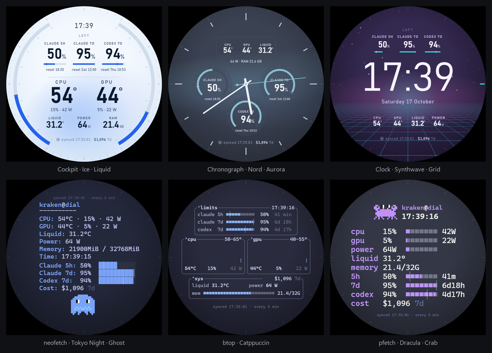
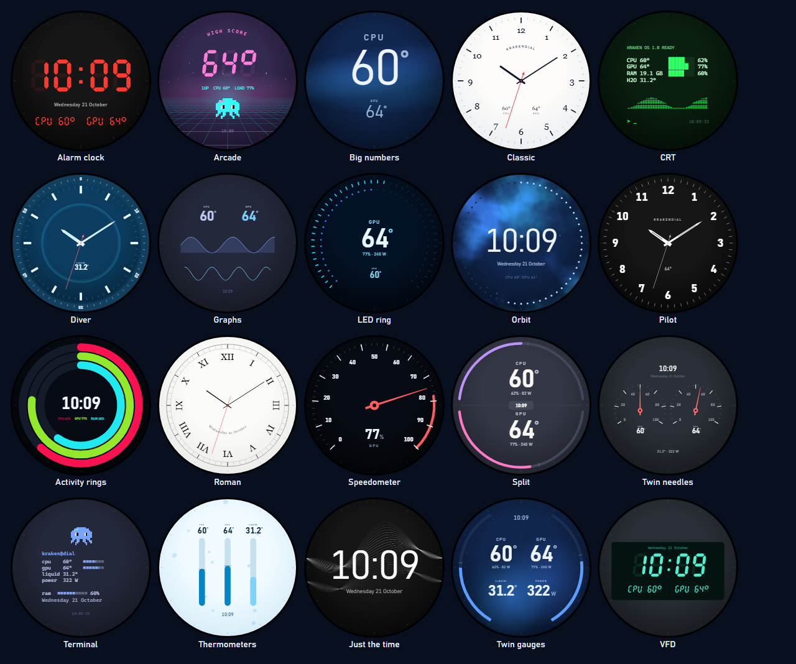
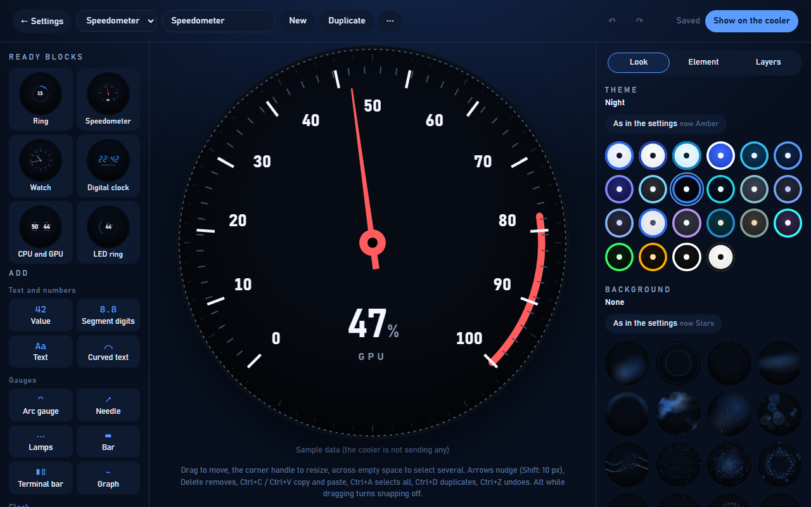

# KrakenDial

[English](README.md)

Otwartoźródłowa tarcza na LCD NZXT Kraken Elite (640×640), wyświetlana przez tryb Web Integration w NZXT CAM. Pokazuje:

- temperatury CPU, GPU i cieczy, obciążenie i moc CPU i GPU, RAM i godzinę;
- opcjonalnie limity Claude (5h, 7d) i Codexa (7d) z kreską tempa oraz ich koszt, ze źródła, które uruchamiasz u siebie;
- 22 gotowe tarcze w galerii, od zegarków i prędkościomierza po zegar VFD i terminal CRT;
- własne tarcze złożone w edytorze z wartości, łuków i lampek, cyfr segmentowych, wskazówek (także zegara), tekstu, obrazków i maskotek.

Tarcza i ustawienia są po angielsku albo po polsku.



Projekt nie jest powiązany z NZXT ani przez nie wspierany. NZXT, CAM i Kraken to znaki towarowe NZXT, Inc.

## Jak to działa

Mała usługa w Ruście (`krakendial.exe`, bez okna, z ikoną w zasobniku, ok. 14 MB RAM) serwuje tarczę pod `http://127.0.0.1:30640/`. CAM wczytuje tę stronę na chłodzeniu i przekazuje do niej odczyty czujników. Usługa trzyma ustawienia i tarcze, a jeśli ustawisz źródło limitów, odpytuje je.

- Słucha tylko na 127.0.0.1.
- Ustawienia zmieniają tylko jej własne strony. Inne strony otwarte w przeglądarce nie mogą ich zmienić, a zapytania z inną nazwą hosta są odrzucane.
- Łączy się tylko ze źródłem limitów, które sam wpiszesz, i z GitHubem raz przy każdym starcie, żeby sprawdzić, czy jest nowe wydanie. Żadnej telemetrii.

## Instalacja

Windows z NZXT CAM i Krakenem Elite. W PowerShellu:

```powershell
irm https://raw.githubusercontent.com/kleju13/krakendial/main/scripts/install.ps1 | iex
```

To pobiera najnowsze [wydanie](https://github.com/kleju13/krakendial/releases), sprawdza je z opublikowaną sumą SHA-256, kopiuje do `%LOCALAPPDATA%\krakendial`, dodaje do menu Start i uruchamia teraz oraz przy każdym logowaniu. Exe nie jest podpisany. Ta sama linia aktualizuje. Od wersji 0.3.0 robi to też *Aktualizacje* na stronie ustawień: pobiera nowe wydanie, sprawdza jego SHA-256 i uruchamia KrakenDial od nowa.

Z klonu repo z zainstalowanym [Rustem](https://rustup.rs) `.\scripts\install.ps1` buduje zamiast pobierać. `.\scripts\uninstall.ps1` zatrzymuje usługę i usuwa autostart oraz wpis w menu Start; `-Purge` kasuje też ustawienia, tarcze i media. [ffmpeg](https://ffmpeg.org) jest opcjonalny: zmniejsza własne filmy do 640×640.

W NZXT CAM: **Lighting** → przy Krakenie **Mode** → **Web Integration** → **Custom Mode** → **Edit**, URL `http://127.0.0.1:30640/`.

## Ikona w zasobniku

Gdy KrakenDial działa, jego ikona jest w zasobniku Windows. Windows 11 może schować nową ikonę pod **^**; przeciągnij ją na pasek, żeby była widoczna.

- **Niebieska:** chłodzenie dostaje tarczę.
- **Szara:** CAM nic nie wysyła, więc tarczy nie ma na chłodzeniu.
- **Czerwona kropka:** źródło limitów nie odpowiada.

Kliknięcie pokazuje stan i opcje **Otwórz ustawienia**, **Edytor tarcz**, **Kopiuj adres dla CAM** (`http://127.0.0.1:30640/`), **Ukryj ikonę…** i **Zakończ KrakenDial**.

Ukrytą ikonę przywraca **Ikona w zasobniku** → **Widoczna** w ustawieniach albo ponowne uruchomienie KrakenDial z menu Start. Po **Zakończ** menu Start uruchamia go znowu.

## Ustawienia

Przycisk **Configure** w CAM albo `http://127.0.0.1:30640/` w przeglądarce otwiera ustawienia z podglądem na żywo. Wybór trafia na chłodzenie w ciągu ok. 3 s.

- **Układ:** 17 wbudowanych układów, tarcze z galerii i twoje własne.
  - Okrągłe: Kokpit, Chronograf, Słupki, Zegar, Jedna liczba, Tylko limity, Tylko sprzęt.
  - Rotacja (limity i sprzęt na zmianę) i Adaptacyjny (sprzęt, gdy GPU pracuje). Te dwa i Tylko limity potrzebują źródła limitów.
  - Terminalowe: Terminal, htop, btop, neofetch, fastfetch, pfetch, macchina, cpufetch. Układy fetch mają maskotkę (Kraken, Krab, Duch, Kot albo Robot), która mruga, rozgląda się i trochę chodzi.
- **Galeria:** 22 gotowe tarcze w pięciu grupach: zegary (Klasyczny, Rzymski, Nurek, Pilot, Budzik, VFD, Orbita), wskaźniki (Prędkościomierz, Dwie wskazówki, Pierścienie, Pierścień diod i inne), retro i terminal, minimalistyczne oraz dwie z limitami AI, które pokazują się, gdy jest źródło limitów. Tarcza z galerii ma własny motyw i tło; wybranie jej zakłada je, a potem możesz je zmienić. **Edytuj kopię** otwiera ją w edytorze jako twoją własną.
- **Motyw:** 22 motywy, m.in. Nord, Tokyo Night, Catppuccin, Dracula, Solarized, Gruvbox i Synthwave.
- **Tło:** 18 rysowanych animacji, od cieczy i zorzy po `donut.c`, ogień, Grę w życie i rury. Przyspieszają razem z obciążeniem GPU.
- **Własne tła:** film, GIF albo obrazek. Może być przyciemniony pod motyw, w oryginale albo narysowany znakami ASCII.
- **Klatki tła na sekundę:** 10, 20 albo 30. CAM renderuje stronę bez GPU i każda klatka na sekundę kosztuje ok. 2–3% jednego rdzenia, więc domyślnie jest 10.
- **Tryb camless:** domyślnie wyłączony. Tylko dla [camless](https://github.com/kleju13/camless), który może pokazywać tarczę zamiast CAM. KrakenDial przekazuje wtedy camless tło raz, jako pętlę, a przeglądarka rysuje tylko wtedy, gdy zmieniają się liczby: z filmem w tle przeglądarka i camless razem biorą ok. 8% jednego rdzenia zamiast ok. 38%. Rysowane tło powtarza się co 20 sekund albo częściej, gdy przyspiesza je obciążenie GPU. Nowe przygotowuje się kilka sekund, film mniej więcej tyle, ile trwa.
- **Paski CPU i GPU:** obciążenie albo temperatura, w układach terminalowych.
- **Język:** automatycznie (z przeglądarki), English albo Polski.
- **Źródło limitów:** skąd przychodzą limity i koszty (niżej). Zostaw puste, jeśli chcesz tylko sprzęt.
- Ze źródłem dochodzą trzy kolejne:
  - **Limity AI:** Claude 5h, Claude 7d i Codex 7d, każdy włączany osobno.
  - **Limity pokazują:** ile zostało albo ile zużyte.
  - **Koszt:** z 24 h, dziś, z 7 dni, w tym miesiącu albo wyłączony.



## Edytor tarcz

`http://127.0.0.1:30640/editor` albo **Moje tarcze** w ustawieniach. Nowa tarcza zaczyna się od jednej z galerii albo od pustej; tarcza w galerii zostaje bez zmian, a ty zmieniasz kopię.

- **Wygląd:** własny motyw i tło tarczy, wybierane z miniatur, albo zostawione ustawieniom. Własne filmy, GIF-y i obrazki dodasz od razu tutaj.
- **Dodaj:** gotowe bloki (pierścień, prędkościomierz, zegarek, zegar cyfrowy, CPU i GPU obok siebie, pierścień diod) i pojedyncze elementy w czterech grupach: tekst i liczby, wskaźniki, zegar, ozdoby. Kliknięcie dodaje na środek, przeciągnięcie tam, gdzie upuścisz.
- **Na tarczy:** przeciągaj, żeby przesunąć; elementy przyciągają się do środka i do siebie nawzajem. Uchwyt w rogu zmienia rozmiar. Przeciągnięcie po pustym miejscu zaznacza kilka naraz: można je razem przesuwać, wyrównywać, przebarwiać, kopiować i usuwać.
- **Element:** cała reszta tego, co zaznaczone. **Warstwy** pokazują wszystko w kolejności rysowania.

Jest cofanie i ponawianie, kopiowanie i wklejanie między tarczami, przesuwanie strzałkami oraz import i eksport do JSON. Zmiany zapisują się na bieżąco. **Pokaż na chłodzeniu** wrzuca tarczę na wyświetlacz razem z jej wyglądem.



Tarcze to pliki JSON w `%LOCALAPPDATA%\krakendial\faces`. Format opisuje [docs/faces.md](docs/faces.md) (po angielsku).

## Limity i koszty

Tarcza nie rozmawia z Claude'em ani Codexem i nigdy nie czyta ich tokenów. Czyta jedno podsumowanie JSON spod adresu wpisanego w **Źródło limitów** albo podanego w zmiennej `KRAKENDIAL_USAGE` przed pierwszym startem. Odpytuje je co minutę i 15 s po tym, jak źródło zapowiedziało odświeżenie.

Takie źródło robisz sam. KrakenDial go nie ma i nie będzie miał, bo każdy zbiera te liczby inaczej. Wystarczy cokolwiek, co na `GET` odpowiada tym JSON-em. Format opisuje [docs/usage-source.md](docs/usage-source.md) (po angielsku).

Każdy układ pokazuje te limity, które są włączone i które źródło wysyła, oraz koszt, jeśli źródło go podaje. Resztę pomija i zsuwa się w jej miejscu. Bez źródła układy pokazują sam sprzęt, a tam, gdzie był stan synchronizacji, datę. Rotacja, Adaptacyjny i Tylko limity pokazują wtedy Tylko sprzęt, a ustawienia ich nie wyświetlają.

## Rozwój

- `http://127.0.0.1:30640/lcd?mock` to sama tarcza ze zmyślonymi odczytami sprzętu.

  Parametry `layout`, `theme`, `bg`, `units`, `look`, `mascot`, `bars`, `cost`, `limits`, `fps` i `lang` wymuszają wariant, np. `/lcd?mock&layout=neofetch&theme=tokyo&mascot=ghost&lang=pl`. Tarcza z edytora to `layout=face:<id>`, tarcza z galerii `layout=gallery:<id>`. `limits=claude5h,codex7d` wybiera limity, `limits=none` wyłącza wszystkie.
- Exe uruchomione z `KRAKENDIAL_WEB=<repo>\web` serwuje pliki strony z dysku, bez przebudowy. Otwarte strony same się przeładowują po restarcie usługi.
- `cargo test` testuje usługę. `node tests/web.js` buduje każdy układ, tarczę z galerii i widżet w obu językach na sztucznym DOM-ie.
- Logi, ustawienia, tarcze i media są w `%LOCALAPPDATA%\krakendial`.

Układ kodu i dodawanie układu, motywu, tła, widżetu albo języka: [CONTRIBUTING.md](CONTRIBUTING.md) (po angielsku).

## Licencja

Copyright (C) 2026 kleju13 i współtwórcy KrakenDial.

[GNU AGPL v3](LICENSE). Można używać, zmieniać i udostępniać za darmo, także w pracy. Kto przekazuje dalej zmienioną wersję albo udostępnia ją innym przez sieć, musi opublikować jej źródła na tej samej licencji.
